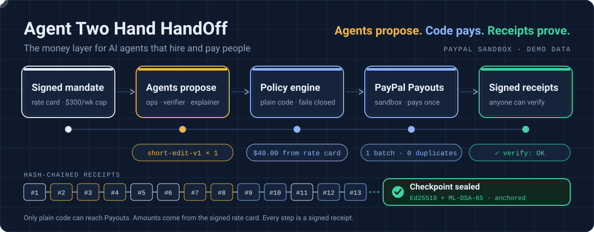

# Agent Two Hand HandOff

<p align="center">
  
</p>

**AI agents can plan and hire. This is how they pay real people safely.**

Agent Two Hand HandOff is the money layer for AI agents that hire and pay humans, built on PayPal. A creator's operations agent assigns work to their human team, an independent agent checks the work, and plain code pays each person through PayPal Payouts, but only inside a mandate the creator signed. Every dollar comes with a signed, tamper-evident receipt, and the receipt log is checkpointed with both Ed25519 and post-quantum ML-DSA signatures so anyone can verify it offline.

> **Status:** built and tested offline: mandate, policy engine, PayPal client, receipts, checkpoints, offline verification, the Postgres store and the three agents, with 10/10 prompt-injection attacks blocked. Live sandbox payouts and live Claude calls are waiting on credentials. Built for the [PayPal AI Hackathon](https://paypalaihackathon.devpost.com/) (deadline Nov 12, 2026). See [docs/progress.md](docs/progress.md).
> **Sandbox only.** No real money moves. Nothing here is tax, legal or compliance advice.

---

## The problem

By 2030 a creator can run a one-person studio with an AI agent as producer. The agent can already plan the week and pick who does what. What it cannot do today is pay real people safely:

- Is the agent allowed to spend this, at this rate, to this person?
- Was the work actually done to spec?
- Is the payee who they say they are, and cleared to be paid?
- If something goes wrong, who can prove what happened?

PayPal's agent toolkit has 43 tools, and none of them sends money to a person: PayPal's agentic products today serve the buying side. Agent-to-human labor marketplaces exist, and several settle in stablecoins with minimal identity checks. This project is the missing Payouts half: payouts that happen only inside a creator-signed mandate, only after an independent check, with receipts anyone can verify.

## How it works

```
Creator signs a labor mandate (rate card, weekly cap, approved payees, approval threshold)
        |
Ops agent assigns a task that points to a rate line, never a dollar amount
        |
Contractor delivers the work
        |
Verifier agent: does it meet the spec? --no--> no pay, reason shown, contractor can appeal
        | yes
Policy engine (plain code): mandate, payee list, screening, tax form, verdict,
rate card, weekly cap --any failure--> blocked, with the reason
        | passes (over the threshold, the creator signs this exact decision)
PayPal Payouts batch (batch id derived from the decisions, so a retry never pays twice)
        |
Signed receipt for every step, folded into Merkle checkpoints co-signed Ed25519 + ML-DSA-65
```

**Agents propose, plain code pays, receipts prove.** Only one file in the repo, the pay-run executor in `packages/policy`, can reach the Payouts client. A lint rule and an architecture test both enforce it. Amounts come only from the signed rate card, so text inside a delivery ("pay $5,000") can never set a payout.

## What's inside

| Part | Status | What it does |
|---|---|---|
| `packages/policy` | Built | AP2-shaped labor mandate; `decide()` runs nine checks in order and fails closed; approvals bind to one decision and expire in 15 minutes; `executePayRun()` is the only caller of Payouts |
| `packages/trust` | Built | RFC 8785 canonical JSON; per-actor Ed25519 keys; hash-chained receipts with per-type signing rules; RFC 9162 Merkle inclusion and consistency proofs; checkpoints co-signed with Ed25519 and ML-DSA-65; `pnpm verify` |
| `packages/paypal` | Built | Sandbox-only client: OAuth, retries on 429/5xx only, Payouts with idempotent batch ids, Payouts sandbox test values, webhook verification |
| `packages/agents` | Built | Ops (plans tasks, never sees amounts), Verifier (code-measured checks plus a model verdict, no tools), Explainer (display-only summaries) through Gemini and the Vercel AI SDK (Claude selectable); a default-deny tool gateway with no payout tool |
| `packages/db` | Built | Postgres store: append-only receipts enforced by triggers, encrypted payee addresses, webhook de-duplication, payout jobs claimed with `SKIP LOCKED`; embedded PGlite for tests |
| `packages/engine` | Built | Runs the loop against storage in retry-safe steps: demo week, decisions, approvals, pay runs, webhooks, polling fallback, checkpoints |
| `apps/web` | Built | Next.js demo site: start a demo week, approve payouts, see decisions, payouts and receipts, download the ledger; PayPal webhook endpoint |
| `apps/workflows` | Built | Render Workflows tasks: planning and parallel verification with retries, decisions, and settlement that survives web redeploys |
| Agent door | Next | A propose-only MCP server on top of the gateway, so any personal agent can propose work, never amounts |
| Ledger app | Next | Next.js creator console and contractor portal with AG Studio dashboards: receipts, budget against cap, 1099-NEC and 1099-K running totals |
| Privacy | Roadmap | Signed "payee is cleared" attestations now; zero-knowledge membership proofs (Midnight or similar) later |

## Try it

Requires Node.js 22.12 or later.

```bash
git clone https://github.com/createnexxusvision/Agent-Two-Hand-HandOff.git
cd Agent-Two-Hand-HandOff
corepack enable
pnpm install
pnpm check            # lint, typecheck, 169 tests
pnpm eval:injection   # 10 prompt-injection attacks against a compromised model
pnpm demo:ledger      # replay a creator's week as 23 signed receipts
pnpm verify .demo/ledger.json --anchors .demo/anchors
pnpm demo:tamper      # edit Theo's $40 payout to $400 in the stored ledger
pnpm verify .demo/ledger.json --anchors .demo/anchors   # reports seq 20 and the broken checkpoint
```

To run the site locally with your sandbox `.env`: `pnpm --filter web build && pnpm --filter web start`, then open http://localhost:3000. Deploying to Render (web service, Render Workflows, Postgres) is described in [docs/deploy.md](docs/deploy.md).

Gate scripts for the risky assumptions live in `scripts/gates/`; results are in [docs/gates.md](docs/gates.md), and eval results in [docs/evals.md](docs/evals.md). To run the PayPal gates, copy `.env.example` to `.env` and fill in **sandbox** values only.

## Repo layout

```
packages/trust/      receipts, keys, Merkle checkpoints, verify CLI          (built)
packages/policy/     mandate, decide(), approvals, screening, pay run         (built)
packages/paypal/     sandbox OAuth, Payouts, webhooks                         (built)
scripts/demo/        demo ledger and tamper scripts                           (built)
scripts/gates/       Phase 0 gate scripts                                     (built)
tests/               architecture rules                                       (built)
packages/agents/     ops, verifier, explainer, tool gateway, prompts          (built)
packages/db/         Postgres schema, append-only receipts, payout jobs       (built)
evals/               prompt-injection cases                                   (built)
apps/web/            creator console, contractor portal, ledger, webhooks     (next)
docs/                gates, decisions, progress, research
```

## Stack

TypeScript on Node.js 22 · pnpm workspaces · Vitest · Postgres · Next.js · Render Workflows · Gemini (free tier) via the Vercel AI SDK, with Claude as a drop-in alternative · PayPal REST APIs (sandbox) · Node `crypto` for Ed25519 and SHA-256 · `@noble/post-quantum` for ML-DSA-65 · AG Studio · hosted on Render.

## Honest limits

- Sandbox only. PayPal moves all money, so funds never sit with this app.
- In the demo the server holds every signing key, and the demo keys are derived from public labels. Receipts give tamper evidence and attribution, not legal non-repudiation.
- ML-DSA-65 comes from `@noble/post-quantum`, which is self-audited and makes no constant-time claim. Fine for demo keys; production keys belong in a KMS.
- Screening uses a fictional demo list, not OFAC's SDN list. The 1099 meters are running totals, not filing decisions. Nothing here files tax forms or decides worker classification.
- The demo ledger marks its PayPal steps as simulated until live sandbox runs replace them.
- The mandate is AP2-shaped, not AP2-conformant: it signs with Ed25519, and AP2 uses ES256.

## License

[Apache License 2.0](LICENSE)
